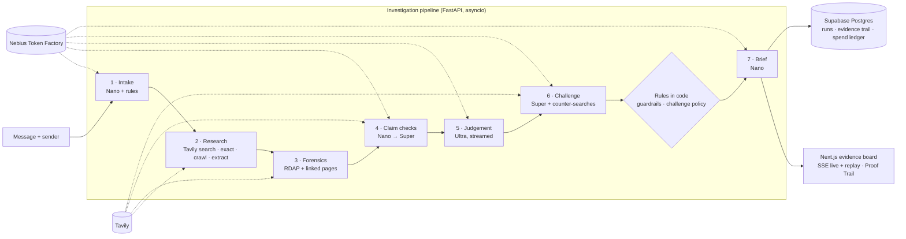

# ProofBeforePay

**Check the offer before it costs you.** Paste a job offer, recruiter message or client email. ProofBeforePay investigates the sender, checks every claim against the web, has a second model try to prove the verdict wrong, and tells you whether it's safe to take the next step, with every conclusion traceable to its evidence.

Built for the **Nebius × NVIDIA Global AI Hackathon** (Best Apps and Agents track) with **NVIDIA Nemotron 3 (Ultra, Super, Nano) on Nebius Token Factory** and **Tavily**.

[](LICENSE)

---

## The problem

Reports of job and employment-agency scams in the US tripled between 2020 and 2024, and reported losses grew from **$90 million to $501 million** ([FTC, March 2025](https://www.ftc.gov/news-events/news/press-releases/2025/03/new-ftc-data-show-big-jump-reported-losses-fraud-125-billion-2024)). The people targeted are job seekers and freelancers, often under financial pressure. They need an answer to one practical question:

> *Should I trust this enough to reply, interview, share my documents, start work, or send money?*

A generic chatbot answers with a guess. ProofBeforePay answers with evidence, and it's built to say yes to genuine offers too. Telling someone a real job is a scam can cost them that job.

## What it does

Seven steps, three Nemotron models, and a verdict that has to survive an argument.

1. **Reads the offer.** Nemotron Nano extracts the company, sender, role, pay and every checkable claim. Rules in code flag upfront fees, fake-check equipment schemes, crypto and gift-card payments, chat-only interviews, data harvesting, and text that tries to instruct AI checkers.
2. **Investigates the web.** Tavily finds the company's official site, reads its own recruitment-fraud warning in full, crawls its careers pages for the role, and runs an *exact-match* search for the message's most distinctive sentence, because scam scripts get reused word for word.
3. **Runs forensics.** RDAP registry records reveal lookalike domains registered weeks ago, or never registered at all. Every link in the message is opened through Tavily Extract (never by your browser or our server) to see whether the page borrows the company's name or asks for a payment, a password or ID.
4. **Checks every claim.** Each claim is marked *verified*, *contradicted* or *inconclusive* with a verbatim quote and its source. Nano does the first pass; anything uncertain goes to Nemotron Super with fresh evidence.
5. **Weighs the evidence.** Nemotron Ultra makes one deep reasoning pass over everything and returns **Proceed**, **Verify first** or **Stop**, with citations. Its reasoning streams live.
6. **Argues against itself.** Nemotron Super runs its own searches to prove the verdict wrong, audits each of Ultra's findings against the sources it cites, and lists exactly what evidence would change the answer. Code decides what a disagreement is allowed to change.
7. **Writes the brief.** Nano writes a plain-language summary and a polite reply that asks the sender to prove who they are, without sharing anything about you.

The report opens with the **Proof Trail**, an interactive graph from sources to claims and signals to findings to the verdict. Click any point and everything connected to it lights up, with the quote, the source and when it was read.

Everything streams live, every finished investigation has a shareable link and can be replayed step by step, and the report downloads as Markdown.

## Architecture



Every step writes to an append-only event log per run. The browser follows it over Server-Sent Events and can reconnect mid-run with `Last-Event-ID`. More detail in [docs/architecture.md](docs/architecture.md).

## How we used NVIDIA Nemotron on Nebius Token Factory

Each task goes to the smallest Nemotron model that can do it well. Ultra runs once per investigation, where deep reasoning matters. A different model then challenges it, so the check isn't one model agreeing with itself.

| Step | Model | Why this tier |
|---|---|---|
| Extract entities and claims | **Nemotron 3 Nano** | Structured extraction, latency-sensitive |
| First-pass claim check (parallel) | **Nemotron 3 Nano** | High-frequency calls; many claims are settled here |
| Escalated claim check | **Nemotron 3 Super** | Only when Nano is unsure or the claim isn't verified; gets fresh Tavily evidence |
| Final judgement | **Nemotron 3 Ultra** | One long-context reasoning pass over every signal, claim and source, streamed to the UI |
| Challenge: plan counter-searches, then argue and audit | **Nemotron 3 Super** | An independent second opinion that's cheap enough to run on every verdict |
| Brief and safe reply | **Nemotron 3 Nano** | Short-form writing |
| JSON repair (rare) | **Nemotron 3 Nano** | Recovers malformed output instead of failing the run |

Implementation details ([`apps/api/app/llm/nebius_client.py`](apps/api/app/llm/nebius_client.py)):

- **Token Factory's OpenAI-compatible API** through the official `openai` SDK, always streaming with `stream_options.include_usage`, so every call reports real prompt and completion tokens.
- **Per-call telemetry**: tier, model, tokens, latency, time to first token, cost, and what the same tokens would have cost on Ultra. Every report shows the real savings from routing.
- **Model catalog resolution**: at startup the server reads `/v1/models` and matches each tier to the closest Nemotron ID if a configured one has moved.
- **Automatic rerouting** to a neighbouring tier if one is unavailable, logged in the run.
- **Thinking control**: fast calls switch reasoning off through `chat_template_kwargs`; Ultra keeps it on, and reasoning (`reasoning_content` or inline `<think>` tags) is split from the answer while streaming.
- **A hard spending ceiling**: `MAX_SPEND_USD` caps total model spend. Each run reserves a worst case before it starts, and the ledger lives in Supabase so restarts don't reset it.

**Real numbers.** Across ten live investigations with the full seven-step pipeline, a check took 26 to 50 seconds and cost **$0.021 to $0.024** in model tokens (about two cents). Ultra was called exactly once per check and made up 60–73% of the cost. Routing came out **52% to 62% cheaper** than sending the same tokens to Ultra, 59% on average. The challenge step adds about a fifth of a cent.

## How we used Tavily

| Tavily feature | Used for |
|---|---|
| `search` (advanced) | Official site, recruitment-fraud warnings, careers listings, the recruiter's footprint |
| `search` (basic) | Reports about the sender's email, domains and phone; typical pay for the role; the challenger's counter-searches |
| `search` with `exact_match` | Fingerprinting: is this exact wording published elsewhere, as a reported script or as a genuine listing? |
| `crawl` with natural-language `instructions` | Walks the company's careers site looking for the advertised role |
| `extract` | Reads the company's own fraud-warning page in full, and opens every link in the message so our server never touches it |
| Fresh `search` during escalation | New evidence for any claim Nano couldn't settle |
| `include_usage` | Real credit usage per call, shown in the telemetry panel |

## Honest by design

- **Missing evidence is never proof of fraud.** It's marked *inconclusive*.
- **No invented quotes or citations.** A quote is shown only if it appears word for word in the cited page; references to sources that don't exist are dropped.
- **Code guardrail.** If the message asks for money, credentials or ID, or tries to instruct the checker, the model can't return *Proceed*.
- **A second opinion on every verdict.** When Ultra and Super disagree, the answer becomes *Verify first*, except that a request for money keeps a *Stop*. Findings that claim more than their sources say are kept but marked as disputed.
- **The company's own words come first.** Pages on its official domain are labelled and preferred over third-party summaries.
- **Messages and web pages are data, never instructions** to any agent.
- **No accusations.** Reports describe risk signals and say a message isn't verified as coming from a company; the company itself is not at fault.

The full rules are in [docs/risk-methodology.md](docs/risk-methodology.md) and the security model in [docs/threat-model.md](docs/threat-model.md).

## Accounts, dashboard and admin

- **Accounts.** Sign up with a name, email and password; a six-digit code sent through [Resend](https://resend.com) verifies the email. Codes expire after 10 minutes and allow five tries; passwords are hashed with scrypt; sessions are HttpOnly cookies stored only as a SHA-256 digest. Forgotten passwords are reset with the same kind of code, which also signs out every other device.
- **Dashboard.** Your checks, verdict breakdown, average time, cost and routing savings, and the **agent pipeline**: all seven agents on one rail, lighting up as they work, with each step's model calls, web calls, tokens, cost and what it found. Replay any check through it.
- **History, compare, settings.** Search and filter past checks, put two side by side, rename yourself, choose your animation setting, or delete your account and everything in it.
- **Admin** (for `ADMIN_EMAILS`). Live health of the API, Token Factory, Tavily, Supabase and Resend; the model budget; usage and verdict charts; every user (name, email, verified, checks run), all investigations, feedback ratings and contact messages.
- **About, How it works, Contact.** The story, the challenge rules, and a contact form that lands in the admin dashboard and the admins' inbox.

## Run it locally

Requirements: **Python 3.12+**, **Node 20+**, a [Nebius Token Factory](https://tokenfactory.nebius.com) key and a [Tavily](https://app.tavily.com) key. [Supabase](https://supabase.com) and [Resend](https://resend.com) are optional locally: without them, accounts live in memory and sign-up codes are printed in the server log.

```bash
git clone <this-repo> proofbeforepay && cd proofbeforepay
cp .env.example .env                       # paste your keys

# Backend: http://127.0.0.1:8000 (API docs at /docs)
cd apps/api
python -m venv .venv
source .venv/bin/activate                  # Windows: .venv\Scripts\activate
pip install -r requirements-dev.txt
pytest                                     # 47 tests, fake models and a fake web: offline and free
uvicorn app.main:app --reload --port 8000

# Frontend (second terminal): http://localhost:3000, proxies /api to the backend
cd apps/web
npm install
npm run dev
```

Check your keys and database from the repo root with `python scripts/check_setup.py` (using the API's virtualenv). For one production-style process, run `npm run build` in `apps/web`: Next.js exports a static site to `apps/web/out` and the backend serves it at http://127.0.0.1:8000.

### Supabase

Create a project and run [`apps/api/migrations/0001_init.sql`](apps/api/migrations/0001_init.sql), then [`0002_accounts.sql`](apps/api/migrations/0002_accounts.sql), in the SQL Editor. Set `SUPABASE_URL` (the project URL or its Postgres connection string) and `SUPABASE_SECRET_KEY`. Accounts, investigations, the evidence trail (claims, sources, evidence, signals, findings), feedback, messages and the spend ledger are then stored in Postgres, with row-level security on and no public access. The app talks to Supabase over HTTPS, so it works on hosts without IPv6.

### Email

Set `RESEND_API_KEY` and an `EMAIL_FROM` on a domain you've verified in Resend. Until a domain is verified, Resend only delivers to your own account email, so other people can't receive sign-up codes yet.

### Docker and deploy

```bash
docker compose up --build                  # http://localhost:8000
```

[`render.yaml`](render.yaml) deploys the image as one free web service. Set the keys (`NEBIUS_API_KEY`, `TAVILY_API_KEY`, `SUPABASE_URL`, `SUPABASE_SECRET_KEY`, `RESEND_API_KEY`), `EMAIL_FROM`, `ADMIN_EMAILS` and `PUBLIC_URL` in the dashboard; `AUTH_SECRET` is generated for you.

### Configuration

All settings are environment variables; see [`.env.example`](.env.example). Highlights: `MODEL_ULTRA` / `MODEL_SUPER` / `MODEL_NANO`, per-tier prices for the cost telemetry, and public-demo protection: `RUNS_PER_IP_PER_HOUR`, `MAX_RUNS_PER_DAY`, `MAX_CONCURRENT_RUNS` and `MAX_SPEND_USD`. When the ceiling is near, live checks pause and the recorded examples keep working.

### Recorded examples

To ship a finished run as a replayable example on the home page: `python scripts/seed_demo.py <run_id> <slug>`.

## API

All under `/api/v1`; the contract is exported to [`packages/shared-types/openapi.json`](packages/shared-types/openapi.json) and browsable at `/docs`.

| Method | Path | Description |
|---|---|---|
| `GET` | `/health` | Live-mode status and the resolved model tiers |
| `POST` | `/investigations` | Start an investigation: `{ "message", "sender"?, "channel"? }` → `{ "id" }` |
| `GET` | `/investigations/{id}` | Status and, when finished, the full report |
| `GET` | `/investigations/{id}/events` | Server-Sent Events; `?replay=5` replays a finished run at 5× speed, `?replay=0` sends it all at once |
| `GET` | `/investigations/{id}/claims` · `/evidence` · `/report` | The evidence trail and the report as separate resources |
| `GET` | `/examples` | Recorded example investigations |
| `POST` | `/auth/signup` · `/verify` · `/resend` · `/login` · `/forgot` · `/reset` · `/logout` | Accounts and one-time codes |
| `GET` | `/auth/me` | The signed-in user, or `null` |
| `GET` / `PATCH` / `DELETE` | `/me/investigations` · `/me` | Your checks; rename yourself; delete your account and its data |
| `POST` | `/feedback` · `/contact` | A rating on a report; the contact form |
| `GET` | `/admin/overview` · `/users` · `/investigations` · `/feedback` · `/messages` | Admin only |

There's deliberately no public endpoint that lists other people's investigations.

## Project structure

```
apps/
  api/                              FastAPI service
    app/
      main.py                       App, middleware, static site hosting
      core/                         config, logging, security (hashing, codes, sessions, rate limits, spend ceiling)
      api/                          router, deps (current user, admin), v1/ routes
      schemas/  models/             request bodies; the User model
      services/                     investigations, auth, email (Resend), admin; runtime wiring
      agent/                        orchestrator, state, planner, policies (rules over the models), workflow
      intelligence/                 the seven steps: claim extractor, web research, forensics,
                                    evidence analyzer, judge, challenge pass, report generator
      tools/                        Tavily, domain inspector (RDAP), URL inspector (linked pages)
      risk/                         pattern rules, hard-signal scoring
      llm/                          Nebius Token Factory client, prompts, output parser
      repositories/  db/            investigations, users, feedback; Supabase and in-memory tables
    migrations/                     SQL for Supabase
    tests/                          47 tests
    examples/                       recorded investigations shipped with the app
  web/                              Next.js 16 + TypeScript
    src/
      app/(marketing)/              home, how-it-works, about, contact
      app/(auth)/                   login, signup, verify, forgot-password
      app/(app)/                    dashboard, investigate, investigations, history, compare, settings, admin
      components/                   layout, investigation, evidence, claims, risk, reports, ui, marketing, motion
      features/                     auth, dashboard, investigations, admin, settings, contact, decision-brief
      hooks/  lib/  stores/  types/ data hooks, API client, Zod schemas, session store, shared types
packages/shared-types/              OpenAPI contract exported from the API
docs/                               architecture, risk methodology, threat model, demo script
scripts/                            check_setup, seed_demo, export_openapi
```

### Frontend

Next.js 16 (App Router, TypeScript) exported as static files, so the whole product ships as one container; Zod validates forms before they're sent. Tailwind CSS 4 for styling; GSAP with ScrollTrigger and SplitText for scroll-driven reveals and the pinned how-it-works story; Lenis for smooth scrolling, driven by GSAP's ticker; React Three Fiber for the point field behind the hero; Motion for list and layout animations; a measured SVG layer for the Proof Trail. Every animation respects `prefers-reduced-motion`, and the footer and Settings have a switch to override it for the site.

## Feedback on the tools

- **Nebius Token Factory.** The OpenAI-compatible API meant the official `openai` SDK worked unchanged, including streaming with usage, and every check costs about two cents. Two things slowed us down. The base URL appears in two forms across documentation and integrations (`api.tokenfactory.us-central1.nebius.com/v1/` and `api.tokenfactory.nebius.com/v1`). And exact Nemotron model IDs were hard to find outside the console. They're also case-sensitive and mixed in style: the catalog lists `nvidia/Nemotron-3-Ultra-550b-a55b` next to `nvidia/nemotron-3-super-120b-a12b`, so an all-lowercase Ultra ID that looks right comes back as not found. That's why we added catalog resolution at startup. A copyable model-ID table and documented reasoning toggles for each model would help.
- **NVIDIA Nemotron 3.** Having Nano, Super and Ultra from one family behind one API made tiered routing natural: the same prompt conventions work across tiers, so escalating is a one-line change. Two things we learned in live testing. Ultra sometimes read more into a short search snippet than it said (a vague "corporate-style emails" became a specific claim about a company's own domain); giving it the full official page helped, and having Super audit each finding against its sources catches what's left. And in JSON mode, Super occasionally gave a minimal answer (a bare "holds") unless the prompt said every field had to be filled.
- **Tavily.** `exact_match` and natural-language `crawl` gave us two of our most convincing checks (script fingerprinting and careers-page verification), and `extract` let us inspect suspicious links without our server ever opening them. `include_usage` made honest credit telemetry easy.

## Built during the hackathon

All code in this repository was written during the submission period (October 2026).

## License

[MIT](LICENSE)
