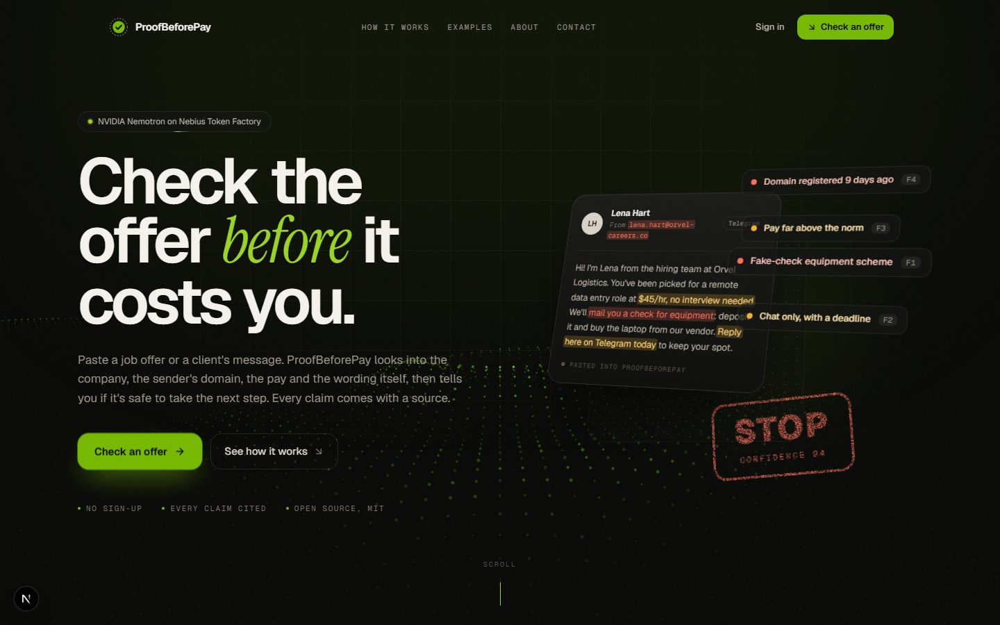
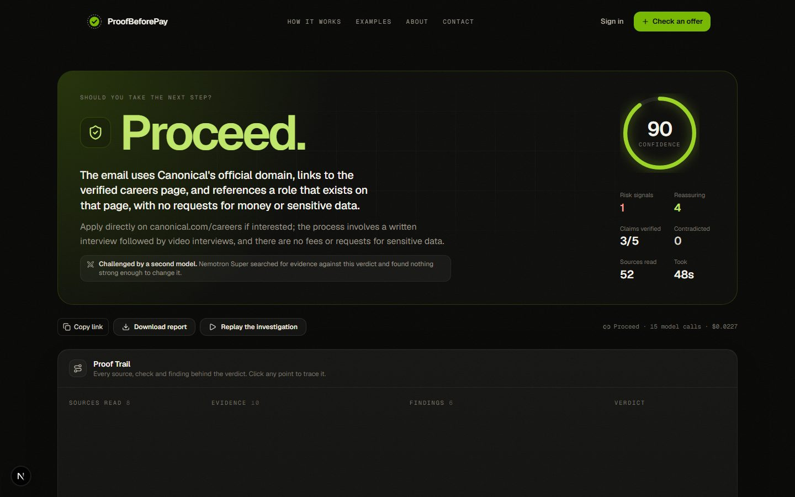
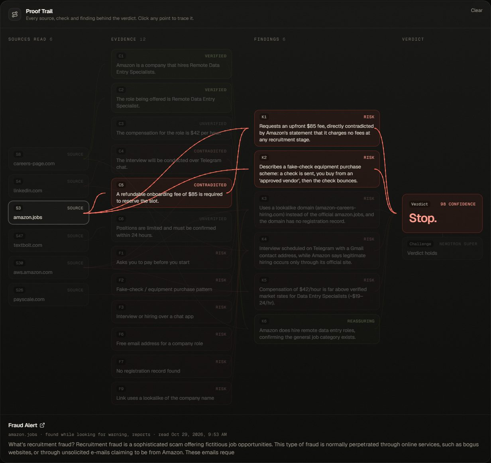
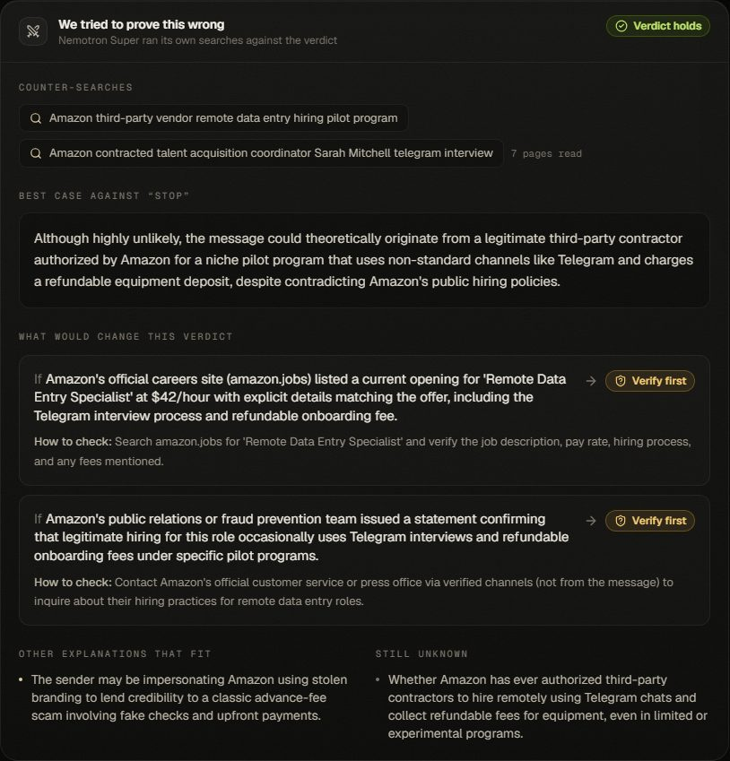
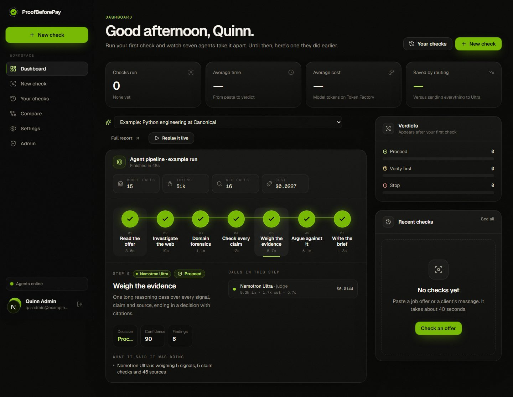
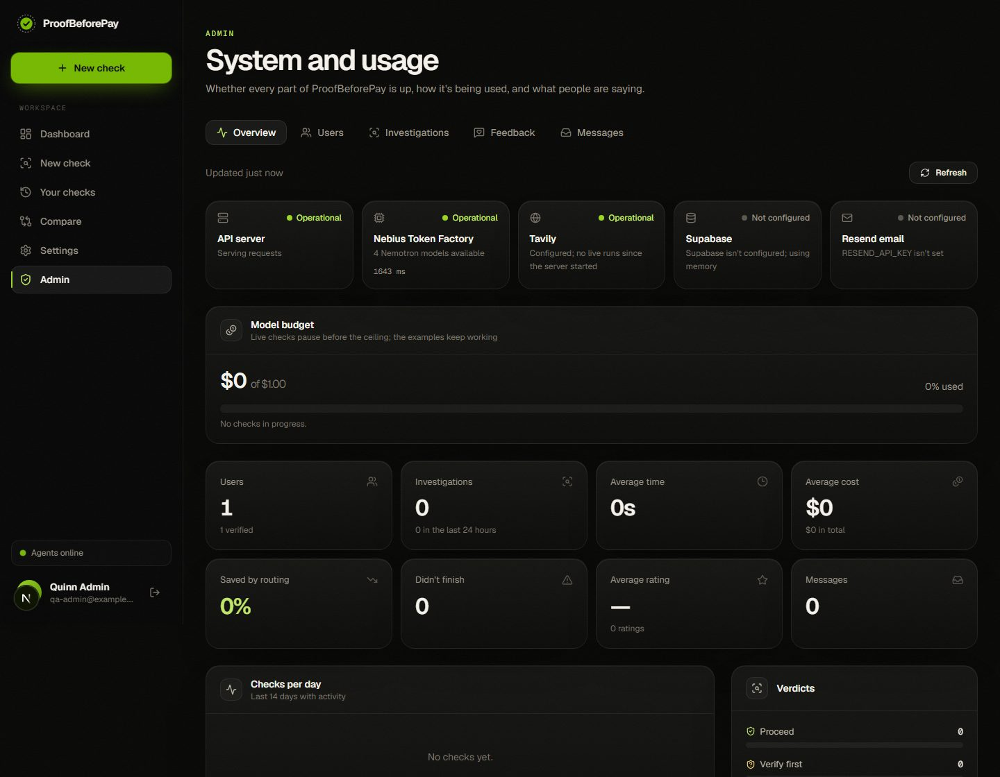
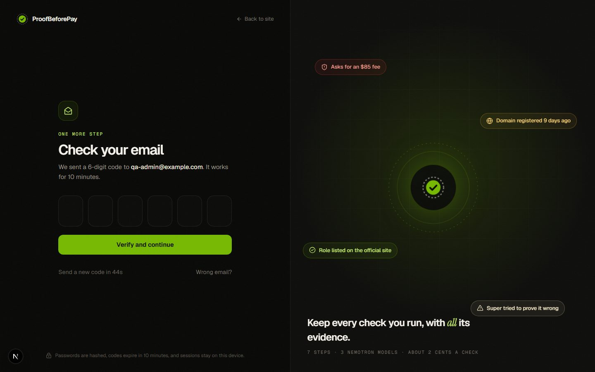

<div align="center">

# ProofBeforePay

**Check the offer before it costs you.**

Paste a job offer, a recruiter's message or a client's email. Seven AI agents check the sender, the company and every claim against the web, a second model tries to prove the verdict wrong, and you get one of three answers, **Proceed**, **Verify first** or **Stop**, with every conclusion traceable to its evidence.

[](https://www.nvidia.com/en-us/ai-data-science/foundation-models/nemotron/)
[](https://nebius.com/token-factory)
[](https://tavily.com)
[](apps/api/tests)
[](LICENSE)

Built for the **Nebius × NVIDIA Global AI Hackathon** · Best Apps and Agents

**Live demo:** [proofbeforepay-qaax.onrender.com](https://proofbeforepay-qaax.onrender.com) · **Video:**(https://youtu.be/JhhcloY57W4) · **Docs:** [architecture](docs/architecture.md) · [how it decides](docs/risk-methodology.md) · [threat model](docs/threat-model.md)



</div>

---

## For judges: try it in one click

Open the [live demo](https://proofbeforepay-qaax.onrender.com) (it may take a minute to wake up), then:

- **No account:** pick a sample on the home page and press *Investigate*, or open a recorded example.
- **Signed-in app:** on [Sign in](https://proofbeforepay-qaax.onrender.com/login), press **Demo account** for the dashboard, agent pipeline, history and compare.
- **Admin dashboard:** press **Demo admin** for live system health, budget, users, feedback and messages. Real people's names and emails are masked in this view.

You can also sign in by hand: `demo.judge@example.com` or `demo.admin@example.com`, password `ProofBeforePay-Demo-2026`. Both demo accounts are shared and can't be renamed, deleted or reset.

## Contents

- [The problem](#the-problem)
- [What it does](#what-it-does)
- [Screenshots](#screenshots)
- [How it works](#how-it-works)
- [How we used NVIDIA Nemotron on Nebius Token Factory](#how-we-used-nvidia-nemotron-on-nebius-token-factory)
- [How we used Tavily](#how-we-used-tavily)
- [Honest by design](#honest-by-design)
- [Tech stack](#tech-stack)
- [Run it locally](#run-it-locally)
- [Deploy](#deploy)
- [Configuration](#configuration)
- [API](#api)
- [Project structure](#project-structure)
- [Testing](#testing)
- [Feedback on the tools](#feedback-on-the-tools)
- [License](#license)

## The problem

Reports of job and employment-agency scams in the US tripled between 2020 and 2024, and reported losses grew from **$90 million to $501 million** ([FTC, March 2025](https://www.ftc.gov/news-events/news/press-releases/2025/03/new-ftc-data-show-big-jump-reported-losses-fraud-125-billion-2024)). The people targeted are job seekers, students and freelancers, often under financial pressure. They need an answer to one practical question:

> *Should I trust this enough to reply, interview, share my documents, start work, or send money?*

Most of these scams are checkable. The "recruiter" writes from a domain registered last week; the company's own careers page says it never charges candidates; the same message is already on a scam forum. The evidence is out there, but nobody has time to dig for it at 11pm when the offer "expires tomorrow". A chatbot gives you a guess. ProofBeforePay gives you the evidence, and it's built to say yes to genuine offers too, because telling someone a real job is a scam can cost them that job.

## What it does

**For anyone, no account needed**

- **One clear answer.** Proceed, Verify first or Stop, with a confidence score and the main reason in one sentence.
- **Watch it work live.** Signals appear, claims flip from *checking* to *verified* or *contradicted*, and Nemotron Ultra's reasoning streams onto the screen.
- **The Proof Trail.** An interactive graph from sources to claims and signals to findings to the verdict. Click any point and everything connected to it lights up.
- **We try to prove ourselves wrong.** Nemotron Super runs its own searches against every verdict, audits each finding against its sources, and lists exactly what evidence would change the answer.
- **Links checked for you.** Every link in the message is opened through Tavily, never by your browser or our server, to see whether the page borrows the company's name or asks for a payment, a password or ID.
- **What to do next.** What not to do yet, questions to ask the sender, and a polite reply that asks them to prove who they are.
- **Paste a screenshot.** Upload, paste or drop a screenshot of the chat or email. A small vision model copies out the text, you check it, and Nemotron does the rest.
- **Ask the report.** Follow-up questions like "Is the pay realistic?" are answered by Nemotron Super from that report's evidence only, with citations you can click.
- **Share, replay, download.** Every check gets a link, replays step by step, and downloads as Markdown or saves as a PDF. The browser tab shows the progress, so you can switch away while it works.

**With a free account**

- **Sign up with an email code.** A six-digit code sent through Resend verifies your email; forgotten passwords are reset the same way.
- **Dashboard.** All seven agents on one live rail: which model ran each step, the web searches it made, the tokens, the cost and what it found. Replay any check through it.
- **History and compare.** Search and filter past checks, or put two side by side.
- **Settings.** Rename yourself, turn animations on or off, or delete your account and everything in it.

**For the team running it**

- **Admin dashboard.** Live health of the API, Token Factory, Tavily, Supabase and Resend; the model budget; usage, verdict and challenge charts; every user (name, email, verified, checks run); all feedback ratings and contact messages. Every table downloads as CSV.
- **Installable.** Add it to your phone's home screen and it opens like an app.

## Screenshots

| | |
|---|---|
|  **A genuine offer gets a Proceed**, with confidence, signals and the reason. |  **The Proof Trail.** Amazon's own page contradicts the fee claim, which feeds two findings, which lead to Stop. |
|  **The challenge.** Super's counter-searches, the best case against the verdict, and what would change it. |  **Dashboard.** Seven agents on one rail, with each step's calls, tokens and cost. |
|  **Admin.** Service health, the model budget, usage and every user. |  **Sign-up** with a six-digit email code. |

## How it works

Seven steps, three Nemotron models, and a verdict that has to survive an argument.


1. **Read the offer.** Nemotron Nano extracts the company, sender, role, pay and every checkable claim. Rules in code flag upfront fees, fake-check equipment schemes, crypto and gift-card payments, chat-only interviews, data harvesting, and text that tries to instruct AI checkers.
2. **Investigate the web.** Tavily finds the official site, reads the company's own fraud warning in full, crawls its careers pages for the role, and runs an *exact-match* search for the message's most distinctive sentence, because scam scripts are reused word for word.
3. **Forensics.** RDAP registry records reveal lookalike domains registered days ago, or never registered at all. Each link in the message is opened through Tavily Extract to see what the page asks for.
4. **Check every claim.** Each claim is marked *verified*, *contradicted* or *inconclusive* with a verbatim quote. Nano does the first pass; anything uncertain goes to Super with fresh evidence.
5. **Weigh the evidence.** Nemotron Ultra makes one long reasoning pass and returns the decision with citations.
6. **Argue against it.** Super searches for evidence that the verdict is wrong, audits each finding against its sources, and lists what would change the answer. Code decides what a disagreement may change.
7. **Write the brief.** Nano writes a plain-language summary and a safe reply to the sender.

Every step writes to an append-only event log that the browser follows over Server-Sent Events (it reconnects mid-run with `Last-Event-ID`). More in [docs/architecture.md](docs/architecture.md).

## How we used NVIDIA Nemotron on Nebius Token Factory

Each task goes to the smallest Nemotron model that can do it well. Ultra runs once per investigation, where deep reasoning matters, and a *different* model challenges it, so the check isn't one model agreeing with itself.

| Step | Model | Why this tier |
|---|---|---|
| Extract entities and claims | **Nemotron 3 Nano** | Structured extraction, latency-sensitive |
| First-pass claim check (parallel) | **Nemotron 3 Nano** | High-frequency calls; many claims are settled here |
| Escalated claim check | **Nemotron 3 Super** | Only when Nano is unsure or the claim isn't verified; gets fresh Tavily evidence |
| Final judgement | **Nemotron 3 Ultra** | One long-context reasoning pass over every signal, claim and source, streamed to the UI |
| Challenge: plan counter-searches, argue and audit | **Nemotron 3 Super** | An independent second opinion, cheap enough to run on every verdict |
| Brief and safe reply | **Nemotron 3 Nano** | Short-form writing |
| JSON repair (rare) | **Nemotron 3 Nano** | Recovers malformed output instead of failing the run |

Implementation ([`apps/api/app/llm/nebius_client.py`](apps/api/app/llm/nebius_client.py)):

- **Token Factory's OpenAI-compatible API** through the official `openai` SDK, always streaming with `stream_options.include_usage`, so every call reports real prompt and completion tokens.
- **Per-call metering**: tier, model, tokens, latency, time to first token, cost, and what the same tokens would have cost on Ultra. Every report and the dashboard show the real savings from routing.
- **Model catalog resolution**: at startup the server reads `/v1/models` and matches each tier to the closest Nemotron ID if a configured one has moved.
- **Automatic rerouting** to a neighbouring tier if one is unavailable, logged in the run.
- **Thinking control**: fast calls switch reasoning off through `chat_template_kwargs`; Ultra keeps it on, and reasoning (`reasoning_content` or inline `<think>` tags) is split from the answer while streaming.
- **A hard spending ceiling**: `MAX_SPEND_USD` caps total model spend. Each run reserves a worst case before it starts, and the ledger lives in Supabase so restarts don't reset it.

**Real numbers.** Across ten live investigations with the full seven-step pipeline, a check took 26 to 50 seconds and cost **$0.021 to $0.024** in model tokens (about two cents). Ultra was called exactly once per check and made up 60–73% of the cost. Routing came out **52% to 62% cheaper** than sending the same tokens to Ultra, 59% on average.

## How we used Tavily

| Tavily feature | Used for |
|---|---|
| `search` (advanced) | Official site, recruitment-fraud warnings, careers listings, the recruiter's footprint |
| `search` (basic) | Reports about the sender's email, domains and phone; typical pay for the role; the challenger's counter-searches |
| `search` with `exact_match` | Fingerprinting: is this exact wording published elsewhere, as a reported script or as a genuine listing? |
| `crawl` with natural-language `instructions` | Walks the company's careers site looking for the advertised role |
| `extract` | Reads the company's own fraud-warning page in full, and opens every link in the message so our server never touches it |
| `include_usage` | Real credit usage per call, shown in the telemetry panel |

## Honest by design

- **Missing evidence is never proof of fraud.** It's marked *inconclusive*.
- **No invented quotes or citations.** A quote appears only if it's found word for word in the cited page; references to sources that don't exist are dropped.
- **Code guardrail.** If the message asks for money, credentials or ID, or tries to instruct the checker, the model can't return *Proceed*.
- **A second opinion on every verdict.** When Ultra and Super disagree, the answer becomes *Verify first*, except that a request for money keeps a *Stop*. Findings that claim more than their sources say are kept but marked as disputed.
- **The company's own words come first.** Pages on its official domain are labelled and preferred over third-party summaries.
- **Messages and web pages are data, never instructions** to any agent.
- **No accusations.** Reports describe risk signals and say a message isn't verified as coming from a company; the company itself is not at fault.

The full rules are in [docs/risk-methodology.md](docs/risk-methodology.md); the security model, including accounts, is in [docs/threat-model.md](docs/threat-model.md).

## Tech stack

| Layer | What we used |
|---|---|
| AI models | NVIDIA Nemotron 3 Nano, Super and Ultra on Nebius Token Factory |
| Web research | Tavily: search, exact match, crawl, extract |
| Backend | Python 3.12+, FastAPI, asyncio, Server-Sent Events, the `openai` SDK, RDAP |
| Database | Supabase Postgres over its REST API, with row-level security |
| Email | Resend (one-time codes) |
| Frontend | Next.js 16 (App Router, static export), React 19, TypeScript, Tailwind CSS 4, Zod |
| Motion and 3D | GSAP (ScrollTrigger, SplitText), Lenis, Motion, React Three Fiber |
| Testing | pytest (47 tests, offline), Playwright for browser checks |
| Deploy | One Docker image on Render |

The Next.js site is exported as static files and served by FastAPI, so the app and the API share one origin: login cookies are first-party, live streaming needs no proxy, and there's one container to deploy. Every animation respects the device's reduced-motion setting, and the footer and Settings have a switch to override it for the site.

## Run it locally

**You need:** Python 3.12 or newer, Node.js 20 or newer, a [Nebius Token Factory](https://tokenfactory.nebius.com) API key and a [Tavily](https://app.tavily.com) API key. [Supabase](https://supabase.com) and [Resend](https://resend.com) are optional locally: without them, accounts are kept in memory and sign-up codes are printed in the backend terminal.

### 1. Get the code and your settings

```bash
git clone https://github.com/TheBossMan110/ProofBeforePay.git
cd ProofBeforePay
cp .env.example .env        # Windows: copy .env.example .env
```

Open `.env` and fill in at least `NEBIUS_API_KEY` and `TAVILY_API_KEY`.

### 2. Start the backend (terminal 1)

**Windows (Command Prompt or PowerShell)**

```powershell
cd apps\api
python -m venv .venv
.venv\Scripts\python -m pip install -r requirements-dev.txt
.venv\Scripts\python -m uvicorn app.main:app --reload --port 8000
```

**macOS / Linux**

```bash
cd apps/api
python3 -m venv .venv
.venv/bin/python -m pip install -r requirements-dev.txt
.venv/bin/python -m uvicorn app.main:app --reload --port 8000
```

The API is now on http://127.0.0.1:8000, with interactive docs at http://127.0.0.1:8000/docs.

### 3. Start the frontend (terminal 2)

```bash
cd apps/web
npm install
npm run dev
```

Open **http://localhost:3000**. The dev server forwards `/api` to the backend on port 8000, so sign-in works exactly as in production.

### 4. Optional checks

```bash
# from the repository root: checks your Token Factory, Tavily, Supabase and Resend settings
apps/api/.venv/Scripts/python scripts/check_setup.py     # macOS/Linux: apps/api/.venv/bin/python
# backend tests (offline, no API calls, no cost)
cd apps/api && .venv/Scripts/python -m pytest            # macOS/Linux: .venv/bin/python -m pytest
```

### Production-style, one process

```bash
cd apps/web && npm run build          # exports the site to apps/web/out
cd ../api && .venv/Scripts/python -m uvicorn app.main:app --port 8000
```

Now FastAPI serves the whole app at http://127.0.0.1:8000. Or with Docker: `docker compose up --build`.

### Troubleshooting

| Problem | Fix |
|---|---|
| `uvicorn` or `pytest` "not recognized", or "Fatal error in launcher" | The virtualenv was moved or copied. Delete `apps/api/.venv` and create it again (step 2). Running through `.venv\Scripts\python -m …` avoids activation entirely. |
| PowerShell: "running scripts is disabled on this system" | You don't need to activate: use `.venv\Scripts\python -m uvicorn …` as above. |
| `Another next dev server is already running` | Next allows one dev server per project. Close the other terminal, or stop the process it names. |
| Port 8000 or 3000 already in use | Stop the other server, or use `--port 8001` and set `API_ORIGIN=http://127.0.0.1:8001` before `npm run dev`. |
| Sign-up says "Accounts are unavailable" | Supabase tables are missing: run both files in `apps/api/migrations` in the Supabase SQL Editor. |
| No email arrives | Without `RESEND_API_KEY` the code is printed in the backend terminal. With a key but no verified domain, Resend only delivers to your own account email. |
| No animations | Your device asks for reduced motion (Windows: Settings → Accessibility → Visual effects → Animation effects). Use the **Animations: On** switch in the footer. |
| "Live checks are paused" | The spending ceiling is close. Raise `MAX_SPEND_USD` in `.env` and restart the backend. |

## Deploy

ProofBeforePay deploys as **one Docker service on [Render](https://render.com)**: the image builds the Next.js site and serves it from FastAPI, so there's nothing to host separately (no Vercel needed).

1. Push this repository to GitHub.
2. In Render, choose **New → Blueprint**, pick the repository, and Render reads [`render.yaml`](render.yaml).
3. Fill in the values it asks for: `NEBIUS_API_KEY`, `TAVILY_API_KEY`, `SUPABASE_URL`, `SUPABASE_SECRET_KEY`, `RESEND_API_KEY`, `EMAIL_FROM`, `ADMIN_EMAILS` and `PUBLIC_URL` (your Render URL; you can correct it after the first deploy). `AUTH_SECRET` is generated for you.
4. Deploy. The first build takes a few minutes; then open `https://<your-service>.onrender.com/api/v1/health`.
5. Optional: set `NEXT_PUBLIC_REPO_URL` to your GitHub URL to show the GitHub button in the header, and redeploy.

On Render's free plan the service sleeps after 15 minutes without traffic and takes about a minute to wake, so open the site shortly before a demo.

### Supabase

Create a project, then run [`apps/api/migrations/0001_init.sql`](apps/api/migrations/0001_init.sql) and [`0002_accounts.sql`](apps/api/migrations/0002_accounts.sql) in the **SQL Editor**. `SUPABASE_URL` can be the project URL (`https://<ref>.supabase.co`) or its Postgres connection string; the app talks to Supabase over HTTPS, so it works on hosts without IPv6. Use the **secret** key (called `service_role` on older projects). Row-level security is on with no policies, so only the server can read or write.

### Email

In Resend, create an API key and verify a domain you own, then set `EMAIL_FROM` to an address on it (for example `ProofBeforePay <hello@yourdomain.com>`). Until a domain is verified, Resend only delivers to your own account email. For a demo without a domain, set `EMAIL_TEST_INBOX` to that email: codes Resend won't deliver go there instead, labelled with who they're for, and the verify page tells people to use a demo account.

## Configuration

All settings are environment variables in `.env` (see [`.env.example`](.env.example) for every option).

| Variable | Required | What it does |
|---|---|---|
| `NEBIUS_API_KEY` | Yes | Nebius Token Factory key for the Nemotron models |
| `TAVILY_API_KEY` | Yes | Tavily key for web research |
| `SUPABASE_URL`, `SUPABASE_SECRET_KEY` | For accounts in production | Postgres for accounts, saved checks, feedback, messages and the spend ledger |
| `RESEND_API_KEY`, `EMAIL_FROM` | For sign-up in production | Sends one-time codes |
| `ADMIN_EMAILS` | For the admin page | Comma-separated emails that can open `/admin` after signing up |
| `EMAIL_TEST_INBOX` | Optional | Without a verified domain, codes go to this inbox instead |
| `DEMO_LOGIN`, `DEMO_JUDGE_EMAIL`, `DEMO_ADMIN_EMAIL` | Optional | The one-click demo accounts (on by default) |
| `PUBLIC_URL` | Recommended | The site's address, used in emails |
| `AUTH_SECRET` | In production | Signs one-time codes; any long random value |
| `APP_ENV` | In production | Set to `production` so codes are never written to the log |
| `MAX_SPEND_USD` | Optional | Hard ceiling on model spend (default $1); live checks pause near it |
| `RUNS_PER_IP_PER_HOUR`, `MAX_RUNS_PER_DAY`, `MAX_CONCURRENT_RUNS` | Optional | Public-demo limits |
| `MODEL_ULTRA`, `MODEL_SUPER`, `MODEL_NANO`, `PRICE_*` | Optional | Model IDs and per-million-token prices for the cost telemetry |
| `MODEL_VISION`, `PRICE_VISION_IN`, `PRICE_VISION_OUT` | Optional | The model that reads screenshots, and its prices |

To ship a finished run as a replayable example on the home page: `python scripts/seed_demo.py <run_id> <slug>`.

## API

Everything lives under `/api/v1`. The contract is exported to [`packages/shared-types/openapi.json`](packages/shared-types/openapi.json) and browsable at `/docs`.

| Method | Path | Description |
|---|---|---|
| `GET` | `/health` | Live-mode status and the resolved model tiers |
| `POST` | `/investigations` | Start an investigation: `{ "message", "sender"?, "channel"? }` → `{ "id" }` |
| `GET` | `/investigations/{id}` | Status and, when finished, the full report |
| `GET` | `/investigations/{id}/events` | Server-Sent Events; `?replay=5` replays at 5× speed, `?replay=0` sends it all at once |
| `GET` | `/investigations/{id}/claims` · `/evidence` · `/report` | The evidence trail and the report as separate resources |
| `GET` | `/examples` | Recorded example investigations |
| `POST` | `/investigations/{id}/ask` | A question about a finished report: `{ "question" }` → `{ "answer" }` with citations |
| `POST` | `/transcribe` | Reads the message out of a screenshot: `{ "image": dataURL }` → `{ "text", "model" }` |
| `GET` | `/stats` | Anonymous totals for the home page: checks run, average time, cost and savings |
| `POST` | `/auth/signup` · `/verify` · `/resend` · `/login` · `/forgot` · `/reset` · `/logout` · `/demo` | Accounts, one-time codes and the demo sign-in |
| `GET` | `/auth/me` | The signed-in user, or `null` |
| `GET` · `PATCH` · `DELETE` | `/me/investigations` · `/me` | Your checks; rename yourself; delete your account and its data |
| `POST` | `/feedback` · `/contact` | A rating on a report; the contact form |
| `GET` | `/admin/overview` · `/users` · `/investigations` · `/feedback` · `/messages` | Admin only |

There's deliberately no public endpoint that lists other people's investigations.

## Project structure

```
apps/
  api/                              FastAPI service
    app/
      main.py                       App, middleware, static site hosting
      core/                         config, logging, security (hashing, codes, sessions, rate limits, spend ceiling)
      api/                          router, deps (current user, admin), v1/ routes
      schemas/  models/             request bodies; the User model
      services/                     investigations, auth, email (Resend), admin; runtime wiring
      agent/                        orchestrator, state, planner, policies (rules over the models), workflow
      intelligence/                 the seven steps: claim extractor, web research, forensics,
                                    evidence analyzer, judge, challenge pass, report generator
      tools/                        Tavily, domain inspector (RDAP), URL inspector (linked pages)
      risk/                         pattern rules, hard-signal scoring
      llm/                          Nebius Token Factory client, prompts, output parser
      repositories/  db/            investigations, users, feedback; Supabase and in-memory tables
    migrations/                     SQL for Supabase
    tests/                          47 tests
    examples/                       recorded investigations shipped with the app
  web/                              Next.js 16 + TypeScript
    src/
      app/(marketing)/              home, how-it-works, about, contact
      app/(auth)/                   login, signup, verify, forgot-password
      app/(app)/                    dashboard, investigate, investigations, history, compare, settings, admin
      components/                   layout, investigation, evidence, claims, risk, reports, ui, marketing, motion
      features/                     auth, dashboard, investigations, admin, settings, contact, decision-brief
      hooks/  lib/  stores/  types/ data hooks, API client, Zod schemas, session store, shared types
packages/shared-types/              OpenAPI contract exported from the API
docs/                               architecture, risk methodology, threat model, demo script, images
scripts/                            check_setup, seed_demo, export_openapi
Dockerfile · docker-compose.yml · render.yaml
```

## Testing

```bash
cd apps/api
.venv/Scripts/python -m pytest        # macOS/Linux: .venv/bin/python -m pytest
```

58 tests cover the full seven-step pipeline, the guardrails, the challenge rules, the hard signals, the API, the spending ceiling, and the account flows: sign-up and email codes, running out of attempts, unverified sign-in, password reset signing out other sessions, ownership of checks, admin-only access, feedback, contact, account deletion, the demo accounts, asking a report, screenshot checks and email test mode. They use fake models, a fake web and an in-memory database, so they run offline in a few seconds and cost nothing.

## Feedback on the tools

- **Nebius Token Factory.** The OpenAI-compatible API meant the official `openai` SDK worked unchanged, including streaming with usage, and every check costs about two cents. Two things slowed us down. The base URL appears in two forms across documentation and integrations (`api.tokenfactory.us-central1.nebius.com/v1/` and `api.tokenfactory.nebius.com/v1`). And exact Nemotron model IDs were hard to find outside the console. They're also case-sensitive and mixed in style: the catalog lists `nvidia/Nemotron-3-Ultra-550b-a55b` next to `nvidia/nemotron-3-super-120b-a12b`, so an all-lowercase Ultra ID that looks right comes back as not found. That's why we added catalog resolution at startup. A copyable model-ID table and documented reasoning toggles for each model would help.
- **NVIDIA Nemotron 3.** Having Nano, Super and Ultra from one family behind one API made tiered routing natural: the same prompt conventions work across tiers, so escalating is a one-line change. Two things we learned in live testing. Ultra sometimes read more into a short search snippet than it said (a vague "corporate-style emails" became a specific claim about a company's own domain); giving it the full official page helped, and having Super audit each finding against its sources catches what's left. And in JSON mode, Super occasionally gave a minimal answer (a bare "holds") unless the prompt said every field had to be filled.
- **Tavily.** `exact_match` and natural-language `crawl` gave us two of our most convincing checks (script fingerprinting and careers-page verification), and `extract` let us inspect suspicious links without our server ever opening them. `include_usage` made honest credit telemetry easy.

## Built during the hackathon

All code in this repository was written during the submission period (October 2026).

## License

[MIT](LICENSE)
