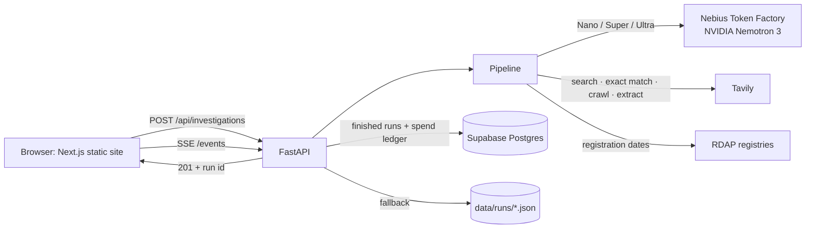

# Architecture

ProofBeforePay is a modular monolith: one FastAPI service runs the investigation and serves the Next.js site as static files. One container, one deploy, nothing to keep in sync. Supabase (Postgres) is optional and holds the investigations and the spending ledger when it's configured.



## One investigation

Each run is an `asyncio` task with an append-only event log. Every step writes events (`stage`, `signal`, `claim`, `source`, `llm_call`, `tavily_call`, `judgement`, `challenge`…) and the browser follows them over Server-Sent Events. A finished run replays from the same log, at its original pace, from a shareable link.

| # | Step | Who does the work | What comes out |
|---|------|-------------------|----------------|
| 1 | Read the offer | Nemotron **Nano** + regex rules | Company, role, pay, sender, up to 6 checkable claims; pattern signals (fees, fake checks, crypto, chat-only interviews, instructions aimed at AI) |
| 2 | Investigate the web | **Tavily** search, exact-match search, crawl, extract | Official domain, fraud warnings (the company's own warning page is read in full), careers pages, reports about the sender, reused copies of the script |
| 3 | Forensics | RDAP + **Tavily Extract** + code | Domain ages, sender-vs-official domain match, lookalike links, what each linked page asks for (payment, login, ID) |
| 4 | Check every claim | **Nano** first, **Super** when Nano is unsure | Each claim verified / contradicted / inconclusive, with a quote that must appear verbatim in the cited page |
| 5 | Weigh the evidence | Nemotron **Ultra**, once, reasoning streamed live | Decision, confidence, findings with citations, next steps |
| 6 | Argue against it | **Super** + fresh Tavily searches | Best counter-argument, what evidence would change the verdict, findings that overstate their sources |
| 7 | Write the brief | **Nano** | Plain-language summary and a safe reply to the sender |

Code, not the models, has the last word on a few things: it drops citations to ids that don't exist, drops quotes it can't find in the source, refuses a Proceed when money, credentials or ID are requested, and decides what a challenge is allowed to change. See [risk-methodology.md](risk-methodology.md).

## Code map

```
apps/api/app/
  agent/          orchestrator (runs the steps), state (run event log), planner (which searches), policies (rules over
                  the models), workflow (stages, logging)
  intelligence/   one module per step: claim_extractor, web_research, forensics, evidence_analyzer, judge,
                  challenge_pass, report_generator
  llm/            nebius_client (tier routing, fallback, streaming, metering), prompts, output_parser
  tools/          tavily_search, domain_inspector (RDAP, official domain), url_inspector (linked pages)
  risk/           rules (patterns), scoring (hard signals)
  services/       investigation_service, auth_service, email_service (Resend), admin_service, runtime (wiring)
  repositories/   investigation_repo, user_repo, feedback_repo, run_store (memory + JSON + examples)
  db/             a small table interface with Supabase (REST) and in-memory implementations
  api/v1/         health, investigations, evidence, reports, auth, me, feedback, contact, admin
  core/           config, logging, security (scrypt, code and session digests, rate limits, spend ceiling)
apps/api/tests/   47 tests; fake models, fake web, in-memory database
apps/web/src/     Next.js App Router: (marketing), (auth) and (app) route groups
```

## Storage

A finished run is written to `apps/api/data/runs/<id>.json` and, when Supabase is configured, to Postgres: one `investigations` row with the report and event log (used for report links and replays), plus the evidence trail as rows in `claims`, `sources`, `evidence`, `signals` and `findings`. Every run's model cost goes into `spend_ledger`, so the spending ceiling survives restarts on hosts with throwaway disks. Accounts (`users`, `email_codes`, `sessions`), `feedback` and `contact_messages` live alongside them. Row-level security is on with no policies; only the server's secret key can read or write.

## Deployment

The Dockerfile builds the Next.js static export in one stage and copies it into the Python image. `render.yaml` describes a single free web service. The site, the API and the docs (`/docs`) all come from the same origin.
